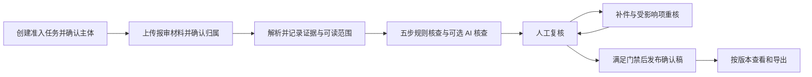

# 工程分包审查项目与代码导读

本文以 2026-11-20 本地 `main` 的 `f4461ff` 为源码基线。线上运行和验收状态来自当日交接记录。第 6 节记录下一版需求。

后续任务及验收见[下一阶段开发总方案](../handoff/2026-11-20-subcontract-next-development-plan.md)。

## 1. 从哪里进入

| 使用场景 | 入口 |
| --- | --- |
| 线上试用 | [工程分包审查工作台](https://106.14.226.88:18088/)。使用已有试用账号登录，通过工作台创建任务并选择核查模式。交接记录中浏览器证书信任仍待验收。 |
| 本地 Compose | 仓库根目录的 [compose.yaml](../../compose.yaml) 编排应用与依赖。前端默认绑定 `127.0.0.1:8088`，可以由 `BS_BIND_ADDRESS` 和 `BS_PORT` 配置。 |
| 前端代码 | [App.jsx](../../frontend/src/App.jsx) 处理登录、会话与工作台挂载。[BlockchainSupervisionWorkbench.jsx](../../frontend/src/plus-ui/blockchain-supervision/BlockchainSupervisionWorkbench.jsx) 管理工作台状态并按任务模式分流。 |
| 后端代码 | [asgi.py](../../backend/app/standalone/asgi.py) 连接运行配置并构建应用。[main.py](../../backend/app/standalone/main.py) 提供登录、会话并注册 `/api/plus/blockchain-supervision`。[router.py](../../backend/app/plus/blockchain_supervision/router.py) 负责分包任务 HTTP 接口。 |
| 模式身份 | [review_mode.py](../../backend/app/plus/blockchain_supervision/review_mode.py) 从任务选项快照读取模式。旧任务无模式字段时按准入读取。 |

[应用反向代理](../../docker/nginx.conf) 将浏览器的 API 请求转给后端。MySQL 持久化业务任务、材料元数据、事件和报告版本。合同原件保存在上传卷。知识检索另见[知识库配置、访问与文件清单](../operations/knowledge-base-guide.md)。

## 2. 准入阶段

下图描述已部署基线的执行链路。单一报告和续跑要求见第 6 节。

| 链路 | 代码与职责 |
| --- | --- |
| 材料与任务准备 | `router.py` 接收上传、材料分类、主体和任务设置。`service.py` 管理任务、材料及相关事件。`parsing.py` 提取页文本和读取状态，扫描页按配置走 OCR。 |
| 核查启动 | `POST /tasks/{id}/start` 启动准入流程。基准、规则、材料关联及参考依据由任务及 [reference_snapshots.py](../../backend/app/plus/blockchain_supervision/reference_snapshots.py) 中的快照记录。 |
| 核查调度 | `router.py` 的 `/check` 及分组接口调用 `service.py` 和核查内核。`/ai-review` 将适用的后台 AI 核查交给 [background_ai_review.py](../../backend/app/plus/blockchain_supervision/background_ai_review.py)。 |
| 五步判定 | [review_flow.json](../../backend/app/plus/blockchain_supervision/data/review_flow.json) 声明流程和依据。完整性与签章由 `a3_check.py`、`signature_chain.py` 等处理。资质与内容合规由 `a2_check.py`、`a1_check.py` 等处理。岗位和证照由 `a2_check.py` 等处理。内部信用与事故由 `internal_records.py` 核对任务内的业主材料。 |
| 人工与报告 | 工作台展示 `findings` 和待处理事项。补件带来新的材料或证据代次。[reporting.py](../../backend/app/plus/blockchain_supervision/reporting.py) 负责报告数据与发布门禁；`report_template_v13.py`、`report_template_v14.py` 和 `report_document.py` 负责相应版式与文档投影。`router.py` 的 `/report` 和 `/report/export` 按阶段或版本读取。 |

## 3. 合同倒查阶段

| 链路 | 代码与职责 |
| --- | --- |
| 受理 | [RetrospectiveWorkspace.jsx](../../frontend/src/plus-ui/blockchain-supervision/RetrospectiveWorkspace.jsx) 挂接上传和进度页面。`PATCH /tasks/{id}/retrospective/contracts` 保存合同关联，`POST /tasks/{id}/retrospective/start` 受理任务。[retrospective_input.py](../../backend/app/plus/blockchain_supervision/retrospective_input.py) 校验合同角色及本版本的双合同门槛。 |
| 后台运行 | [retrospective_runtime.py](../../backend/app/plus/blockchain_supervision/retrospective_runtime.py) 冻结文件、材料版本、基准日、依据和模型身份，写入进度与检查点。[retrospective_sources.py](../../backend/app/plus/blockchain_supervision/retrospective_sources.py) 管理合同页、签订日期及依据来源。 |
| 查规则与比合同 | `retrospective_knowledge.py` 检索依据，`retrospective_coverage.py` 记录逐条覆盖，`retrospective_analysis.analyze` 按批处理条款候选。`retrospective_upstream.compare` 提取并比对合同两侧的义务和条件。 |
| 核实结果 | `retrospective_analysis.review_candidates` 复读上下文处理候选；`retrospective_visual.verify_findings` 校对最终发现的原页。覆盖不足、失败和待核原因进入运行结果。 |
| 保存与交付 | `retrospective_report.build_report` 将核查结果生成报告数据，运行时保存版本。`GET /tasks/{id}/retrospective` 用于读状态和报告，`/report/export` 使用已保存结果。用户侧流程为上传材料、智能核查、查看报告。产品要求沿用现有问题列表，逐条显示问题、合同文件、条款、页码和依据。 |

任务 8 在真实环境自动保存并导出报告，状态为 `partial`，最终 0 条问题。交接记录列明分批失败、规范待核、总分包比对及两处原页差异。内容质量验收仍待完成。见[倒查交接](../handoff/2026-11-20-contract-retrospective-continuation-handoff.md)。

## 4. 规则如何形成判定

| 层次 | 维护入口和职责 |
| --- | --- |
| 依据原文与定位 | `data/basis_clauses.json` 保存本地条款资料，`data/basis_index.json` 提供依据坐标，WeKnora 提供已授权的语义检索和原件关联。法律条文、合同义务和企业管理要求分别记录来源。 |
| 条件与参数 | 准入在 `data/review_flow.json`、`data/review_basis.json`、`data/ruleset.json` 及负面清单、资质、人员等专题数据维护。合同倒查有专属依据、覆盖和对照逻辑。 |
| 事实与证据 | `parsing.py` 提供页文本和读取状态，核查内核按任务主体、材料角色、条款、字段及页码形成事实。合同文本支持约定相关的结论，实际履约需要人员、审批、支付等对应证据。 |
| 核查与复核 | 对条件明确、证据足够的规则执行结构化判定。语义分析提出候选，证据验证和上下文复核核实其成立条件。只读范围、证据冲突及未完成批次影响覆盖状态。 |
| 报告 | 正文和表格消费已确认的结果，使用同版本事实、证据、依据和处置意见。规则归属及版本参见[规则维护基线](../design/2026-11-20-rule-ownership-baseline.md)。 |

## 5. 准入九维与报告样稿

准入报告按用户确认沿用[十一维归并追踪表](../design/2026-11-20-retrospective-56-rule-evidence-map.md)的九项名称及原顺序。原有准入五步是执行流程，九维用于组织核查成果和报告内容。

1. 分包范围与主体资格
2. 报审程序、审批权限与分包行为
3. 关键岗位与作业人员配置
4. 施工设备与起重机械
5. 危大工程与专项施工方案
6. 分包合同条款与总包衔接
7. 质量、安全、进度与环保约定
8. 计量计价、支付、担保与保险
9. 农民工工资与用工保障

参考《工程分包合规核查意见》共 9 页。第 1 页是标题、标段及核查概况，第 1–4 页为建设单位审查意见，第 4–8 页为签约前核查明细，第 9 页是综合审查结论。

- **核查概况**包含工程名称、分包单位、分包标的或范围、合同金额、核查基准日、依据、核查范围及状态释义。
- **审查意见**分别陈述资质与承接能力、安全生产许可、人员配置与持证、范围和负面清单、合同主要条款、报审及补正、综合意见。
- **签约前核查明细**按合规性、现场机构人员、价款计量、质量安全环保保修、工期违约和工资信用组织。每行包括审查项、结论、核查情况、补正要求、责任单位。
- **报审材料清单**包括序号、材料名称、提交情况、核查说明、责任单位。建议在数据层区分已提交、部分提交、未提交、已提交但证据暂不可核，以及应在开工等后续节点提交。
- **综合审查结论**包含结论选项、重大风险、整改期限、责任人和签署区。空白字段和签署位置属于模板结构，意见及签署由相应人员确认。

文字按“具体事实→证据位置→差异或影响→下一步”编排。比如“人员名单与证书所列同一岗位的证号不一致，分别见两份材料的对应页。请核对证书原件及对应人员。”样稿内同一份社保证明在不同位置出现相反描述，部分依据与主体也需复核。报告应从同一组经核实的材料事实生成正文、附件和结论。样稿中的四档状态、管理决定和法规引用有各自的业务含义，需另行对齐系统的准入口径。

## 6. 下一版需求与当前差距

| 需求 | 已运行的行为和下一版方向 |
| --- | --- |
| 总包有则对照 | 当前新建倒查要求双合同。下一版以分包合同为必需，有同项目、同标段且适用的总包时执行双侧比对。缺少对应总包时仍核分包自身及规范，并披露双侧比对范围。 |
| 核查后发现需补材料 | 准入沿用原任务中的补件、人工复核和重核。倒查启动后若需补传或换合同，另建任务并按新任务的完整材料重新核查。同一批倒查材料因执行中断时，在原任务续跑。 |
| 主体信息不一致 | 最终问题列表分别引用总包承包人与分包发包方的原文和位置，说明差异、现有授权或变更证据以及比对范围。某一侧证据缺失时写清待核字段。以分包合同自身及适用依据继续核查。 |
| 两模式默认日期为空 | 倒查已有空日期和分包签订日回填路径。准入工作台目前调用 `todayInChina()`，需连同服务端默认值、启动及历史任务兼容一起核对。人工日期优先沿用既有口径，自动日期以唯一可信的分包签订日为来源，缺失或冲突时保留未知。 |
| 上海细则继续参审 | 两种模式均以细则作对照核查。若具体问题仅由该细则支持且核查基准日早于施行日，保留该发现并注明「与现行细则第×条要求存在差异，核查基准日早于细则施行日，具体适用性请人工判别」。有当时适用的独立依据时，历史判断按该依据作出。证照有效期、社保期间等业务日期仍需用对应证据计算。 |
| 初筛后再核结论 | 倒查已具有自动上下文复核。建议加强现有节点，对角色、适用范围、选择项、例外、文件优先顺序和反证逐条复读，记录保留、排除和待核理由。准入的待人工处理项仍进入相应工作台流程。 |
| 两种报告的文字整理 | 两种模式共用报告表述环节。对照固定模板与受约束的模型润色，只整理标题、问题说明和处理建议。多处证据分别解释其作用；全文未查见时说明核查范围和应有约定的依据。程序保留判定、原文和位置。保存后的同版本报告供界面和导出共同读取。 |
| 核查未完成与报告生成 | 下一版使用单一报告流程。应核规则执行中断时，时间线写明受影响范围和原因。用户点击「重新核查」续跑，复用当前有效的已完成结果。准入保留人工复核页现有的「待处理」「无法核实」「已处理」三项，处理完全部必须处理的「无法核实」项后才可生成报告。 |
| 新版准入规则 | 新版 PDF 的 11 维 83 条是准入规则补充材料。保留原规则编号和来源，逐条核对后映射到准入九维。 |
| 倒查报告展示 | 沿用现有问题列表，指出问题是什么、出现在哪份合同哪一页哪一条，并列明依据。仓库原有的[倒查分析分类](../design/2026-11-20-retrospective-9-dimension-taxonomy.md)和[56 条追踪](../design/2026-11-20-retrospective-56-rule-evidence-map.md)作为实现与来源记录。 |

新版映射 PDF 的主表在第 2–7 页，包含维度、审查要点、适用类别、规则编号、规则名称、可判定条件、取证字段、依据条款、判定与处置。第 1 页的八类合同台账、第 7 页的负面清单分类矩阵及第 7–8 页的参数调整表，分别为取证、条件分支和规则差异提供参考。导入规则库前按规则编号对齐原表、正式依据、证据字段、适用模式及报告状态。

SH-FB-04 的可判定条件按用户指定文字更新为「拟分包标的为部分单位工程、分部工程或分项工程，且不属于负面清单所列内容。不得将全部工程或一个完整单位工程整体对外发包。」该项归入第 1 维「分包范围与主体资格」。范围关系和负面清单适用性分别举证。用户确认，单个完整单位工程只占上游承包范围的一部分时，就该事实列为待核，并说明应补核的直接依据。独立命中负面清单等禁止条件时，按对应规则判定。详见 [OpenSpec](../../openspec/changes/bs-admission-nine-dimensions-sh-fb-04/specs/bs-admission-rule-mapping/spec.md)。
